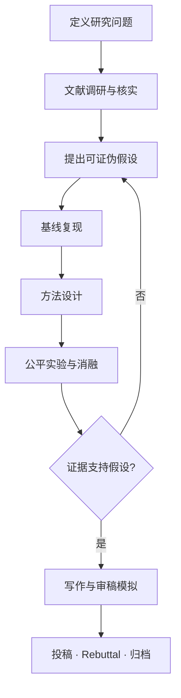
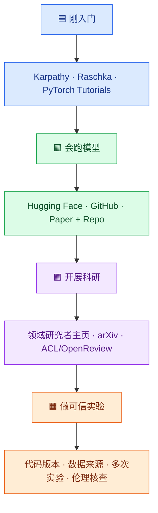

# 🧭 AI 科研新手村

> 🟦 **FOUNDATIONS**　 ·　 🟩 **HANDS-ON**　 ·　 🟪 **RESEARCH**　 ·　 🟧 **RESPONSIBLE AI**  
> **2026 Edition | AI Research Starter Guide**

> [!TIP]
> **怎样使用本指南**：先浏览知识地图，按“直觉 → 系统 → 实践 → 研究”选择资源；不追求把每个链接都刷完。每次学习至少产出一份能验证的代码、笔记或实验记录。

> **2026 Edition · From Foundations to Independent Research**  
> 新入组本科生与研究生入门指南｜循序渐进、动手验证、科研诚信

**学习理念**：基础知识与科研实践同步进行。AI 可以辅助解释、检索、写代码和审查，但学生必须理解原理、验证证据，并对研究结论负责。

---

## 📚 目录 · Table of Contents

> 点击章节标题快速跳转。建议先阅读 **01–02 基础路线**，再根据任务选择 **03–08**，各部分也可独立使用。

| 章节 | 内容 | 适用目的 |
|:--|:--|:--|
| [🧭 01 · 学习路线](#section-01) | 技术知识地图与阶段目标 | 建立全局认知 |
| [🟦 02 · 基础学习与资源](#section-02) | 数学、Python、ML、DL、Transformer、LLM、LMM、Agent | 从直观入门到进阶 |
| [🟩 03 · 应用方向](#section-03) | 选择适合自己的方向 | 明确发展路径 |
| [🟪 04 · 科研方法论](#section-04) | 定义问题、综述、方法、复现、实验、写作、投稿 | 独立开展研究 |
| [🟧 05 · 负责任使用 AI](#section-05) | 学术诚信、验证与安全 | 避免常见风险 |
| [🟦 06 · 十六周训练计划](#section-06) | 阶段里程碑与能力检验 | 制定学习节奏 |
| [🟩 07 · 工具与 Research OS](#section-07) | 文献、代码、实验、写作协作 | 落实科研工作流 |
| [🌍 08 · 学者与开源社区](#section-08) | 研究者主页、博客、论文与社区 | 建立长期信息源 |

> **显示说明**：目录采用 Markdown 锚点，在 GitHub 和支持 HTML 锚点的 Markdown 阅读器中可跳转。导入 Notion 后若锚点未保留，可将对应条目改为 Notion 的“链接到区块”或使用自动目录块 `/table of contents`。

---

<a id="section-01"></a>
## 🧭 01 · 一张图理解学习路线


**概念提示**：AI 是广泛的研究领域；ML 是 AI 的重要分支；DL 是 ML 中的主要方法之一；Transformer 是模型架构；LLM/LMM 是基础模型类型；Agent 是利用模型、工具、状态和反馈解决任务的系统方式。这些概念并不是一条简单的包含关系。

### 如何阅读本指南

- **入门**：先建立直觉与词汇表，不追求公式细节。
- **系统**：完成课程中的经典算法、练习和小项目。
- **进阶**：读原始论文、理解模型局限、复现代码。
- **验收**：能解释、能实现、能给出可验证证据。

| 阶段 | 核心知识 | 最小可交付成果 | 建议时间 |
|---|---|---|---|
| A 基础 | Python、数学、Git、ML | 一个含对照实验的传统 ML 项目 | 1–4 周 |
| B 深度学习 | PyTorch、训练与反向传播 | 一个可复现神经网络实验 | 5–6 周 |
| C 模型架构 | Attention、Transformer、LLM | 手写 attention + 本地模型推理 | 7–10 周 |
| D 前沿专项 | LMM、Agent、RAG、后训练 | 小型工具调用 Agent 或多模态任务 | 11–12 周 |
| E 科研实践 | 文献、复现、方法、实验、写作 | Mini research report + 可复现仓库 | 13–16 周 |

> **时间是参考，不是门槛。** 数学或编程基础较弱的学生可以延长 A/B 阶段；已有基础的学生可提前开展复现。

---

<a id="section-02"></a>
## 🟦 02 · 基础知识路径与分层学习资源

> 资源筛选原则：优先大学公开课程、官方文档、可靠教材和原始论文；由浅入深，**每个主题不必全部学完**。部分英文课程可配合中文字幕或 AI 解释学习，但以原始材料为准。

### A1. 数学、Python 与科研工程基础

**掌握内容**：向量与矩阵、导数/梯度/链式法则、概率分布与条件概率、期望方差、基本统计；Python 基础、NumPy、Pandas、可视化、Linux shell、Git 和虚拟环境。

| 层次 | 推荐资源及链接 | 建议怎么学 |
|---|---|---|
| 直观 | [3Blue1Brown · Linear Algebra](https://www.3blue1brown.com/topics/linear-algebra)；[Calculus](https://www.3blue1brown.com/topics/calculus) | 看图理解向量、变换、导数和梯度 |
| 系统 | [MIT 18.06 Linear Algebra](https://ocw.mit.edu/courses/18-06-linear-algebra-spring-2010/)；[Python 官方教程](https://docs.python.org/3/tutorial/) | 补线性代数、独立编写 Python |
| 实践 | [NumPy Learn](https://numpy.org/learn/)；[Git 官方书 Pro Git](https://git-scm.com/book/en/v2)；[The Missing Semester](https://missing.csail.mit.edu/) | 用 Git 管理实验代码，学 shell/SSH/调试 |

**小练习**：只用 NumPy 实现线性回归或逻辑回归梯度下降；提交 README、训练曲线和一次失败排查记录。

<details><summary>🧪 Toy Demo A1 · 用 NumPy 从零学习一条直线（可直接运行）</summary>

**任务**：给定 6 组模拟数据，学习关系 `y ≈ 2x + 1`。不使用 scikit-learn 或深度学习框架，自己实现 MSE 和梯度更新。

```python
import numpy as np
import matplotlib.pyplot as plt

x = np.array([0., 1., 2., 3., 4., 5.])
y = np.array([1.0, 2.9, 5.1, 6.8, 9.2, 11.0])
w, b, lr = 0.0, 0.0, 0.02
losses = []

for epoch in range(1000):
    pred = w * x + b
    error = pred - y
    loss = np.mean(error ** 2)
    losses.append(loss)
    dw = 2 * np.mean(error * x)
    db = 2 * np.mean(error)
    w -= lr * dw
    b -= lr * db

print(f"w={w:.3f}, b={b:.3f}, final MSE={losses[-1]:.4f}")
plt.plot(losses)
plt.xlabel("Epoch")
plt.ylabel("MSE")
plt.title("Training loss")
plt.show()
```

**应当观察到**：`w` 接近 2、`b` 接近 1，损失总体下降。**思考题**：把 `lr` 改成 `0.5` 会发生什么？为什么即使模型参数接近真实值，MSE 通常也不是零？

**交付**：`linear_regression_numpy.py`、损失曲线截图、100 字以内的结果解释。首次运行需要 `numpy` 和 `matplotlib`。

</details>

### A2. 机器学习（ML）

**掌握内容**：监督/无监督学习、回归与分类、决策树、SVM、聚类；training/validation/test、过拟合、数据泄漏、指标与交叉验证。

| 层次 | 推荐资源及链接 | 建议怎么学 |
|---|---|---|
| 直观 | [Google Machine Learning Crash Course](https://developers.google.com/machine-learning/crash-course/) | 动画、交互与小练习建立直觉 |
| 系统 | [Andrew Ng · Machine Learning Specialization](https://www.coursera.org/specializations/machine-learning-introduction)；[《动手学深度学习》基础篇](https://zh.d2l.ai/) | 系统掌握模型、损失、泛化 |
| 进阶 | [Stanford CS229](https://cs229.stanford.edu/)；[scikit-learn User Guide](https://scikit-learn.org/stable/user_guide.html) | 推导算法，掌握实验评估规范 |

**小练习**：在公开数据上比较 Logistic Regression、Random Forest 与小型 MLP；记录划分方式、指标、误差案例和模型选择原因。

> 🧪 **Toy Demo A2 · 鸢尾花分类器擂台**：使用 scikit-learn 内置 `load_iris()`，固定 `train_test_split(..., test_size=0.2, random_state=42, stratify=y)`；分别训练 `LogisticRegression(max_iter=1000)`、`RandomForestClassifier(random_state=42)` 与 `MLPClassifier(max_iter=1000, random_state=42)`。比较 **accuracy、macro-F1 与 confusion matrix**。**思考**：为什么只看 accuracy 不够？小数据集上一次划分能说明什么、不能说明什么？

### B1. 深度学习（DL）与 PyTorch

**掌握内容**：神经网络、反向传播、autograd、optimizer、学习率、batch、regularization、CNN/RNN、checkpoint、训练/验证曲线。

| 层次 | 推荐资源及链接 | 建议怎么学 |
|---|---|---|
| 直观 | [3Blue1Brown · Neural Networks](https://www.3blue1brown.com/topics/neural-networks) | 直觉理解神经元、反向传播 |
| 系统 | [《动手学深度学习》](https://zh.d2l.ai/)；[PyTorch Learn the Basics](https://docs.pytorch.org/tutorials/beginner/basics/intro.html) | 边学概念边写训练循环 |
| 进阶 | [fast.ai Practical Deep Learning](https://course.fast.ai/)；[Stanford CS231n](https://cs231n.stanford.edu/) | 学调参、视觉模型与工程实践 |

**小练习**：独立训练 Fashion-MNIST/CIFAR-10；比较一个超参数或模型组件的影响；说明 control variables。

> 🧪 **Toy Demo B1 · Fashion-MNIST 手写训练循环**：用 PyTorch 构建 `Flatten → Linear(784,128) → ReLU → Linear(128,10)`，训练 3 个 epoch；只改变学习率 `1e-3` 与 `1e-2`，其他配置固定。绘制训练损失、验证准确率。**思考**：两组实验是否使用了相同的 seed、划分与 optimizer？如果验证准确率波动，如何判断不是随机偶然？

### C1. Transformer 与 NLP

**掌握内容**：tokenization、embedding、Q/K/V、scaled dot-product attention、多头注意力、位置编码、mask、encoder/decoder、self-supervision。

| 层次 | 推荐资源及链接 | 建议怎么学 |
|---|---|---|
| 直观 | [The Illustrated Transformer](https://jalammar.github.io/illustrated-transformer/)；[3Blue1Brown · Transformers](https://www.3blue1brown.com/topics/neural-networks) | 先看动态图，理解信息怎样流动 |
| 系统 | [Stanford CS224N](https://web.stanford.edu/class/cs224n/)；[Hugging Face LLM Course](https://huggingface.co/learn/llm-course/) | 结合 NLP 任务与模型代码学习 |
| 进阶 | [Attention Is All You Need（原始论文）](https://arxiv.org/abs/1706.03762)；[The Annotated Transformer](https://nlp.seas.harvard.edu/annotated-transformer/) | 对照公式和 PyTorch 实现 |

**小练习**：手写简化 self-attention，比较有无 attention mask 的输出；清楚解释每个 tensor 的形状。

> 🧪 **Toy Demo C1 · 三个 Token 的 Attention**：设 `X` 为 `3×4` 的小矩阵，先令 `Q=K=V=X`，计算 `softmax(QKᵀ/√4)V`；然后施加**因果 mask**（第 1 个 token 不能看到第 2、3 个，第 2 个不能看到第 3 个），观察 attention 权重变化。**交付**：原始权重矩阵、加 mask 后权重矩阵、逐个张量的 shape。**思考**：为什么 mask 应用于 softmax *之前*？

### C2. LLM：从使用到理解训练与推理

**掌握内容**：pretraining、next-token prediction、SFT、LoRA/PEFT、preference optimization、RAG、tool calling、KV cache、推理成本、幻觉与评测。

| 层次 | 推荐资源及链接 | 建议怎么学 |
|---|---|---|
| 直观 | [Andrej Karpathy · Neural Networks: Zero to Hero](https://karpathy.ai/zero-to-hero.html)；[Hugging Face LLM Course](https://huggingface.co/learn/llm-course/) | 逐步建立从 token 到生成的理解 |
| 系统 | [Hugging Face Transformers Documentation](https://huggingface.co/docs/transformers/index)；[PEFT Documentation](https://huggingface.co/docs/peft/index) | 运行、评测、适配小模型 |
| 进阶 | [Stanford CS336 · Language Modeling from Scratch](https://cs336.stanford.edu/)；[InstructGPT](https://arxiv.org/abs/2203.02155)；[LoRA](https://arxiv.org/abs/2106.09685) | 理解模型训练系统、对齐和高效微调 |

**小练习**：运行一个公开小模型，比较 base/instruct 与 prompt 变化，记录可复现的评测集、生成参数与错误类型。算力允许时增加一个微型 LoRA 实验。

> 🧪 **Toy Demo C2 · 小模型的指令遵循测试**：选择同一家族、规模相近且授权允许的 Base 与 Instruct 模型，准备 **20 道固定任务**（如 JSON 格式抽取、短文本分类、简单推理）。设置一致的 `temperature=0`（若支持）、最大输出长度、模型版本和提示模板，比较 **格式通过率、任务正确率、拒答/幻觉案例**。**思考**：为什么不同模型的 tokenizer/chat template 可能使比较不完全公平？

### D1. LMM / MLLM：视觉、语音与多模态

**掌握内容**：视觉/语音编码、模态融合与对齐、多模态 instruction tuning、图文/语音生成、缺失模态、数据偏差和评测。

| 层次 | 推荐资源及链接 | 建议怎么学 |
|---|---|---|
| 直观 | [Hugging Face Audio Course](https://huggingface.co/learn/audio-course/)；[Stanford CS231n](https://cs231n.stanford.edu/) | 分别理解声音与图像的表示 |
| 系统 | [Hugging Face Multimodal Models Guide](https://huggingface.co/docs/transformers/tasks/image_text_to_text)；[CLIP 原论文](https://arxiv.org/abs/2103.00020) | 学视觉-语言对齐及模型使用 |
| 进阶 | [LLaVA 原论文](https://arxiv.org/abs/2304.08485)；[Whisper 原论文](https://arxiv.org/abs/2212.04356) | 阅读架构、数据与评测设计 |

**小练习**：比较两种图文提示或一个公开 ASR 模型在噪声条件下的表现，分析 failure cases；不要以几个演示样本代表泛化性能。

> 🧪 **Toy Demo D1 · 为语音识别加入噪声**：准备 10 条拥有正确转写、且有合法使用许可的短语音，用一个公开 ASR 模型分别识别干净语音与加轻度白噪声的语音；用相同规范化规则计算 **WER** 并保存典型错误。**思考**：是否需要控制语音长度、音量和采样率？10 条样本为什么只能说明趋势而非模型的泛化性能？

### D2. Agent、Multi-Agent 与科研工具链

**掌握内容**：planning、tool calling、memory、reflection、observation-action-feedback、state、sandbox、multi-agent coordination；比较 agent 系统与普通单轮模型的成本和可靠性。

| 层次 | 推荐资源及链接 | 建议怎么学 |
|---|---|---|
| 直观 | [Hugging Face Agents Course（中文）](https://huggingface.co/learn/agents-course/zh-CN/unit0/introduction) | 从 Tools/Actions/Observations 入门 |
| 系统 | [Hugging Face Agents Course](https://huggingface.co/learn/agents-course/)；[LangGraph Documentation](https://docs.langchain.com/oss/python/langgraph/overview) | 做有状态、可观测的 agent 工作流 |
| 进阶 | [ReAct](https://arxiv.org/abs/2210.03629)；[SWE-agent](https://arxiv.org/abs/2405.15793) | 学轨迹、工具接口与环境反馈 |

**小练习**：构造一个只有 1–2 个工具的 Agent，设置超时/异常/工具调用预算，比较无工具、单 Agent 和多 Agent 方案的正确率与调用成本。

> 🧪 **Toy Demo D2 · 带计算器的任务 Agent**：给模型 20 道包含小数和括号的算术题；建立 `calculator(expression)` 工具（使用**安全解析器**，不要直接 `eval` 未可信输入）。对比“模型直接回答”和“模型选择调用计算器”，记录 **准确率、工具调用次数、失败率、平均响应时间**，设置 3 次调用上限。进阶时再引入第二个检查 Agent，并检验额外调用成本是否值得。

### 选修：强化学习、模型服务与高效计算

- 强化学习理论：[Sutton & Barto · Reinforcement Learning（作者资料页）](http://incompleteideas.net/book/the-book-2nd.html)；[OpenAI Spinning Up](https://spinningup.openai.com/en/latest/)。
- 模型推理服务：[vLLM Documentation](https://docs.vllm.ai/)；[SGLang Documentation](https://docs.sglang.ai/)。
- 训练框架与实际工程：先掌握 PyTorch 与实验可复现性，再根据项目需求学习分布式训练、量化、RL fine-tuning。

---

<a id="section-03"></a>
## 🟩 03 · 应用方向：按兴趣选一个主线

应用方向不是必须按顺序学完的另一条知识链。建议在有共同基础后选择一项深入：

| 方向 | 常见问题 | 推荐起点 | 初级科研练习 |
|---|---|---|---|
| NLP 与 LLM | 文本理解、生成、对齐、检索 | CS224N / HF LLM Course | 一个固定 benchmark 上的 baseline 对比 |
| CV 与视觉语言 | 分类、检测、VLM、视频理解 | CS231n / CLIP | 模型失败案例与 domain shift 分析 |
| Speech / Audio | ASR、TTS、语音表示 | HF Audio Course | 公开语音数据上的鲁棒性测试 |
| Agent / Multi-Agent | 工具使用、长程任务、协作 | HF Agents Course / ReAct | 单 Agent 与多 Agent 的公平对照 |
| AI for Healthcare | 医疗文本/影像、多模态与隐私 | 通用模型基础 + 医疗数据规范 | 公开数据上的跨域和公平性评估 |
| Foundation Model Methods | 数据效率、微调、后训练、推理 | CS336 / PEFT | 数据规模、质量与训练效率的消融 |

> 研究方向是一组**问题和方法**，不是一系列流行工具名。不要因为一个方向“热门”就跳过任务定义、数据与评测。

---

<a id="section-04"></a>
## 🟪 04 · 科研方法论：从想法到可信证据



### Step 1 · 怎样定义一个好的研究问题？

**不够好**：“用大模型改进某个任务。”  
**更好**：“在什么数据条件、什么任务和约束下，新机制相较哪些 baseline，在什么指标上改善？是否存在成本或公平性权衡？”

研究问题至少写清：**Task、Gap、Hypothesis、Comparator、Metric、Constraint、Failure condition**。每个假设应可被实验否定。

### Step 2 · 怎样进行 Literature Review？

1. 从 survey、经典论文和最近 2–3 年代表工作入手，再追踪必要的最新预印本。
2. 使用同义词、任务名、方法类别、benchmark 组合搜索；留存检索时间与来源。
3. 回到原文核对 DOI、作者、venue、代码、数据与具体实验结果；区分 arXiv 与正式出版。
4. 使用 Zotero 管论文原文及 BibTeX；使用 Paper Card 记录 Problem、Method、Evidence、Limitations、Relation。
5. 将 related work **按方法与假设分类**，而不是逐篇排列摘要。

### Step 3 · 怎样设计 Method？

先说清创新点在哪里：数据、表示、架构、训练目标、优化方式、推断策略还是系统协议？然后写出为什么这一变化**应该**产生效果，明确理论/经验依据、所需数据、伪代码/损失函数以及潜在失败机制。多加模块并不天然构成学术创新。

### Step 4 · 怎样复现公开 Baseline？

检查论文与仓库版本、许可证、依赖、数据、checkpoint；记录 commit、seed、配置、硬件和执行命令。先跑最小 sanity check，再按原评价协议评测。**代码运行成功 ≠ 结果复现成功**。

### Step 5 · 怎样设计实验？

| 类型 | 核心科研问题 | 关键检查 |
|---|---|---|
| Main comparison | 比哪些基线更好？ | 相同 split / 指标 / 预算 |
| Ablation | 哪个机制带来效果？ | 控制变量、清晰替代假设 |
| Sensitivity | 参数是否敏感？ | 范围合理，显示趋势 |
| Robustness / OOD | 能否泛化？ | 独立场景与分布偏移 |
| Efficiency | 多花的代价是否值得？ | 时间、显存、tokens、成本 |
| Error analysis | 失败发生在哪里？ | 有代表性的类别与样本 |
| Stability | 结果是否偶然？ | 多 seed、方差或置信区间 |

每次实验至少填写 Experiment Card 的 Goal、Hypothesis、Config、Command、Results、Interpretation、Next Actions。任何提升都应考虑额外数据、参数量、训练预算、数据泄漏和测试集调参等替代解释。

### Step 6 · 怎样写论文？

**Introduction**：背景 → 精确问题 → 现有方法差距 → 核心机制 → 证据 → Contributions。  
**Related Work**：分类、方法联系与关键差异。  
**Method**：形式化、核心机制、算法与实现细节。  
**Experiments**：公平 baseline、主结果、消融、稳健性、错误分析。  
**Limitations/Ethics**：适用范围、成本、失效情形与风险。

先写 outline 和 evidence map，再写完整段落。论文写作使用 Zotero / BibTeX / Overleaf，避免AI自动编造 citation。

### Step 7 · 投稿、模拟审稿与 Rebuttal

投稿前按当届官方 CFP 检查 venue 匹配、双盲要求、篇幅、supplement、作者署名、伦理和 AI 使用政策。审稿模拟至少覆盖 **Novelty、Soundness、Experiments、Clarity、Reproducibility**。Rebuttal 应直接回应问题、提供真实证据、说明修改位置；不伪造追加实验。

参考：[NeurIPS Paper Checklist](https://neurips.cc/public/guides/PaperChecklist)；[ACL Anthology](https://aclanthology.org/)；[OpenReview](https://openreview.net/)。

---

<a id="section-05"></a>
## 🟧 05 · 负责任地使用 AI

| 情形 | 推荐做法 | 不可接受的做法 |
|---|---|---|
| 学基础 | 先独立尝试，再让 AI 解释错误 | 不理解就提交完整生成代码 |
| 文献调研 | AI 辅助搜索、筛选与归纳；逐条核实 | 杜撰论文、DOI、BibTeX、结果 |
| 写代码 | 让 AI 生成脚手架与测试；自己执行验证 | 不看 diff、不测就提交 |
| 做实验 | AI 提出假设与替代解释；结果来自真实日志 | 捏造数据、选择性隐瞒失败 |
| 写论文 | 用 AI 润色和检查逻辑；按政策披露 | AI 生成未经核实的科学结论 |
| 涉及敏感材料 | 使用授权数据和合规环境 | 上传未授权患者、审稿或私有数据 |

**一条底线**：AI 辅助可以提高科研生产率，但不转移研究者对事实、方法、实验和署名的责任。课程或会议政策可能不同，必须遵守所在单位与当届 venue 的具体规定。

---

<a id="section-06"></a>
## 🟦 06 · 十六周入门训练计划

| 周次 | 学习重点 | 交付物 |
|---|---|---|
| 1–2 | Python / Git / Linux / NumPy | 有说明的基础代码库 |
| 3–4 | ML / 数据划分 / 指标 | 一个 baseline 对比 + 5 张 Paper Cards |
| 5–6 | PyTorch / DL / 训练 | 训练日志、误差分析、复现 README |
| 7–8 | Attention / Transformer | 手写 attention + paper presentation |
| 9–10 | LLM / LoRA / 模型评测 | 小模型评测报告 + Project Card |
| 11–12 | LMM 或 Agent | 一个专项 mini-project + 初步实验矩阵 |
| 13–14 | Ablation / 稳健性 / 失败分析 | Experiment Cards + 可复现结果 |
| 15–16 | 论文结构 / 模拟审稿 / 汇报 | 4–6 页 Mini Research Report |

### 完成检查：看能力，不看“刷课时长”

- [ ] 能用自己的话解释 ML、DL、Transformer、LLM、LMM 和 Agent 的关系。
- [ ] 能手写并测试一个小型神经网络或 attention 核心模块。
- [ ] 能读懂论文中的研究问题、方法、baseline、指标与关键图表。
- [ ] 能复现一个公开 baseline 或完整记录不能复现的原因。
- [ ] 能设计包含对照组与消融的实验，并如实报告结果。
- [ ] 能写一份引用准确、结论审慎的 mini research report。

---

<a id="section-07"></a>
## 🟩 07 · 工具与 Research OS 协作规范

| 工作内容 | 推荐工具 | 产物 |
|---|---|---|
| 学习 / Brainstorm | 教材、公开课、ChatGPT | 学习笔记、Project Card |
| Literature Review | Scholar、Semantic Scholar、arXiv、Zotero | Paper Card、Related Work Matrix |
| 查找数据与代码 | Hugging Face、GitHub、官方 benchmark | Dataset/Repo Card |
| 实现和复现 | Python、PyTorch、Git、Cursor（可选） | 代码与可运行脚本 |
| 实验 | CSV/MLflow/TensorBoard 等 | 日志、Experiment Card、结果表 |
| 写作 | Overleaf、LaTeX、Zotero | Writing Section Card、paper draft |
| 内部审稿 | 人工互审 + AI 辅助检查 | 缺陷清单与 revision plan |

**每周组会四句话**：本周研究问题是什么？做了什么？有什么可查的证据？下一步准备怎样验证？

> **导师寄语**：科研不是比谁更快调用新模型，而是比谁能提出值得回答的问题、建立可靠证据，并诚实解释发现和局限。

---


---

<a id="section-08"></a>
## 🌍 08 · 值得长期关注的研究者、技术博客与开放科研社区

> 🟪 **为什么关注研究者，而不仅关注模型榜单？** 高质量研究习惯来自持续阅读论文、原始代码、技术复盘与开放讨论。以下名单强调**研究成果公开、技术交流活跃或对青年研究者有较强启发价值**，并非严格的年龄排名，也不构成学术影响力榜单。研究者岗位、博客活跃程度和仓库状态可能变化，以各自主页为准。

### 8.1 研究者与技术作者：按学习目的选择

| 关注领域 | 研究者 / 作者 | 官方入口 | 为什么值得学生关注 | 适合阶段 |
|---|---|---|---|---|
| 🔵 从零理解神经网络和 LLM | **Andrej Karpathy** | [GitHub / nanochat / micrograd](https://github.com/karpathy) · [主页](https://karpathy.ai/) | 用相对精炼的代码解释自动微分、语言模型、推断与训练 | 入门 → 进阶 |
| 🔵 LLM 教程、模型机制、后训练 | **Sebastian Raschka** | [技术博客](https://sebastianraschka.com/blog/) · [书籍与配套代码](https://sebastianraschka.com/books/) · [GitHub](https://github.com/rasbt) | 图解与可执行代码结合，尤其适合把概念变成实现 | 入门 → 进阶 |
| 🟣 模型推理、效率与系统 | **Tri Dao** | [研究主页](https://tridao.me/) · [FlashAttention](https://github.com/Dao-AILab/flash-attention) | 从 attention 的计算和 IO 成本思考算法与系统设计 | 进阶 |
| 🟣 LLM 量化与可及性 | **Tim Dettmers** | [个人网站](https://timdettmers.com/) · [GitHub](https://github.com/timdettmers) | 关注量化、低资源训练与工程可用性 | 进阶 |
| 🟠 基础模型训练、对齐与 RL | **Nathan Lambert** | [Interconnects](https://www.interconnects.ai/) · [AI2 开放模型](https://allenai.org/) | 从开放模型研究实践分析 post-training、RL 和模型训练生态 | 进阶 |
| 🟠 AI 工程与生产系统 | **Chip Huyen** | [个人主页与博客](https://huyenchip.com/) · [GitHub](https://github.com/chiphuyen) | 理解数据、部署、评价、系统可靠性与产品化之间的关系 | 入门 → 进阶 |
| 🟢 推理与工具使用 | **Denny Zhou** | [论文与个人主页](https://dennyzhou.github.io/) | 通过推理、self-debugging、工具与优化研究学习问题定义 | 进阶 |
| 🟢 语言、知识与推理 | **Yejin Choi** | [论文与课程](https://yejinc.github.io/) | 关注语言模型的常识、推理、训练与评价问题 | 进阶 |
| 🟢 基础模型评价方法 | **Percy Liang** | [Stanford CRFM](https://crfm.stanford.edu/) · [HELM](https://github.com/stanford-crfm/helm) | 学习如何构建可复查的 benchmark 与系统性评价；注意 HELM 已进入维护模式 | 进阶 |
| 🟢 机器人学习与泛化 | **Chelsea Finn** | [研究组官网](https://rail.eecs.berkeley.edu/) | 研究学习算法、机器人和任务迁移，适合理解从模型到行动 | 进阶 |

> [!NOTE]
> **阅读方法建议**：选 2–3 位长期关注即可。每月阅读 1 篇论文或 1 篇长技术文章，记录“研究问题、关键机制、证据、局限、我想复现什么”。不要仅转发文章标题或把作者观点当作确定事实。

### 8.2 值得收藏的长期资源库与开源社区

| 社区 / 平台 | 官方链接 | 关注内容 | 推荐用途 |
|---|---|---|---|
| 🧠 **Hugging Face** | [Models](https://huggingface.co/models) · [Datasets](https://huggingface.co/datasets) · [Learn](https://huggingface.co/learn) | 开放模型、数据集、课程和社区讨论 | 学习、检索、复现 |
| 🧪 **PyTorch** | [官方教程](https://pytorch.org/tutorials/) · [GitHub](https://github.com/pytorch/pytorch) | 深度学习框架、训练系统与开源贡献 | 基础与工程 |
| 🧬 **Allen Institute for AI (Ai2)** | [研究主页](https://allenai.org/) · [GitHub](https://github.com/allenai) | 开放模型、数据、评价与 AI 研究 | LLM、科学开放性 |
| 🧭 **Stanford CRFM** | [研究和博客](https://crfm.stanford.edu/) | Foundation Models、评价与社会影响 | 研究问题与评价 |
| 📚 **ACL Anthology** | [论文库](https://aclanthology.org/) | NLP、语言模型、语音/多模态相关论文 | 查正式论文与引用 |
| 📄 **arXiv / OpenReview** | [arXiv](https://arxiv.org/) · [OpenReview](https://openreview.net/) | 预印本、公开评审讨论与论文版本 | 跟踪前沿与反思审稿 |
| 🛠️ **GitHub** | [Trending](https://github.com/trending) · [Explore](https://github.com/explore) | 开源实现、issue、release、commit | 学习真实工程过程 |
| 🩺 **PhysioNet** | [官方网站](https://physionet.org/) | 生理信号及医疗研究数据、课程与工具 | 医疗 AI 数据规范 |
| 🔬 **MONAI** | [项目官网](https://monai.io/) · [GitHub](https://github.com/Project-MONAI/MONAI) | 医学影像 AI 框架与可复用组件 | 医疗图像实践 |
| 🗣️ **SpeechBrain** | [官网](https://speechbrain.github.io/) · [GitHub](https://github.com/speechbrain/speechbrain) | 语音识别、说话人和语音深度学习 | Speech 专项 |
| 🎨 **Papers with Code** | [网站](https://paperswithcode.com/) | 论文/代码/任务入口（需核验维护与时效） | 找 baseline 线索 |

### 8.3 不同阶段的推荐订阅组合



### 8.4 每月一次的开放科研阅读挑战

- [ ] **人物**：从上表选 1 位研究者，浏览其最近 2–3 篇代表作品并核查发表状态。
- [ ] **技术**：从其公开代码选一个可以运行的最小 demo 或一个公式进行复现。
- [ ] **科研**：写 1 张 Paper Card，指出问题、创新、实验、局限和可能的替代解释。
- [ ] **分享**：用 5 分钟解释“这项工作解决了什么”和“还有什么没解决”，给出处和运行证据。

---

### 🎯 最后记住

> **Learn the foundations · Read the sources · Build and test · Question the evidence · Share responsibly.**  
> 扎实的基础、可证伪的问题、可复现的实验，以及对结果的诚实解释，比追逐任何一个暂时领先的模型更加重要。

*版本：2026-10 · 建议每学期检查资源链接、研究者主页与投稿规范；本文的色彩通过 Markdown 标识与 Mermaid 节点配色呈现，Notion 对 Mermaid/提示块的支持随导入方式有所不同。*

